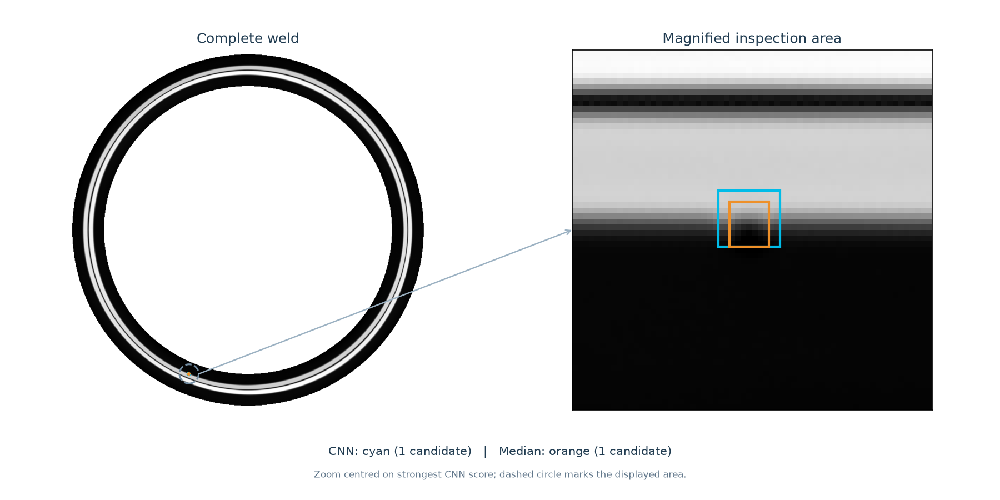

# Synthetic circular-weld imaging and surface-pore detection

Thesis submission code for Sean Leong's **Synthetic Circular-Weld Imaging and Surface-Pore Detection**.

The project generates four-quadrant backscattered-electron (BSE) signals, forms and unwraps TOPO contrast, and compares a neighbouring-median detector with TinyDefectSegNet. It studies effective acquisition counts and training-background diversity. Findings concern synthetic surface-opening pores; the image model is not calibrated to measured weld images.

## Start here

1. Install Python 3.12 and create an environment.
2. Install the dependencies below.
3. Run the bundled example or open the studio.
4. Consult the evidence and reproduction guide for the thesis experiments.

```powershell
python -m venv .venv
.venv\Scripts\python -m pip install -r requirements-studio.txt
.venv\Scripts\python submission.py demo --mask examples/open_intrinsic_mask.npy
.venv\Scripts\python submission.py gui
```

On macOS/Linux, use `.venv/bin/python` instead. The GUI requires Tk. Windows is the original development platform; other platforms are not validated here. Model inference runs on CPU by default.

The demo writes a detection figure, score arrays and numerical results into `demo_output/`. Reference masks are used only for evaluation after inference. The GUI can create synthetic welds and inspect aligned images using the same frozen thesis methods. The **Research tools** menu leads to historical campaigns whose full data are not bundled; use the two main workspaces for this submission.



## Main findings

The final comparison uses 48 new backgrounds, 192 pore scenes and 96 clean scenes per count level. A match requires periodic bounding-box IoU >= 0.5.

| Effective counts | CNN F1 | Corrected-median F1 |
|---|---:|---:|
| 1x | 0.755 | 0.255 |
| 4x | 0.894 | 0.368 |
| 64x | 0.929 | 0.385 |

At 64x, the median produced an overlapping prediction for 147 of 192 openings, but only 68 satisfied the matching criterion. The diagnostics distinguish finding pore-related contrast from localising an opening. These results do not establish a general limit on classical detection methods.

## Package map

| Location | Purpose |
|---|---|
| `submission.py` | Portable launcher and frozen-method demo |
| `DataSimulation/bse_renderer/` | Geometry, detector response, acquisition and image formation |
| `WeldDefectDetection/count_study/` | Main training-noise and background-diversity experiment |
| `WeldDefectDetection/median_localisation_20261110.py` | Selected median, box corrections and fresh confirmation |
| `WeldDefectDetection/inspection/` | Synthetic generation and image-inspection GUI |
| `assets/` | Frozen CNN checkpoint, median calibration and normalisation |
| `examples/` | Two saved confirmation images, masks and expected predictions |
| `docs/` | Retained methods, results and experimental records |
| `evidence/` | Compact thesis evidence snapshots and follow-up results |
| `DataSimulation/data/output/` | Saved numerical campaign records, without full image populations |
| `output/median_*/` | Supplementary experiment reports |

See [reproduction and scope](REPRODUCIBILITY.md) and [evidence notes](evidence/README.md).

## Verification

```powershell
.venv\Scripts\python verify_submission.py
.venv\Scripts\python verify_submission.py --inference
```

The first command verifies package hashes. The second also compares predictions from both frozen methods with the original saved boxes for the two examples. This is a delivery check, not a new performance experiment.

## Scientific scope

- Effective-count multipliers are not image magnification or calibrated physical exposures.
- TOPO represents detector contrast, not a reconstructed height map.
- The main task assumes known ring geometry and one pore per defective scene.
- Training/validation/confirmation are split by background, not by individual related image.
- Original research records retain their provenance paths. The submission launcher uses relative paths.
- Full generated image populations, intermediate score arrays and all historical checkpoints are not distributed in this compact package.
- AI working instructions and editorial drafts are excluded. Experimental records are retained according to their evidentiary role; their presence does not imply a claim about how their prose was authored.
