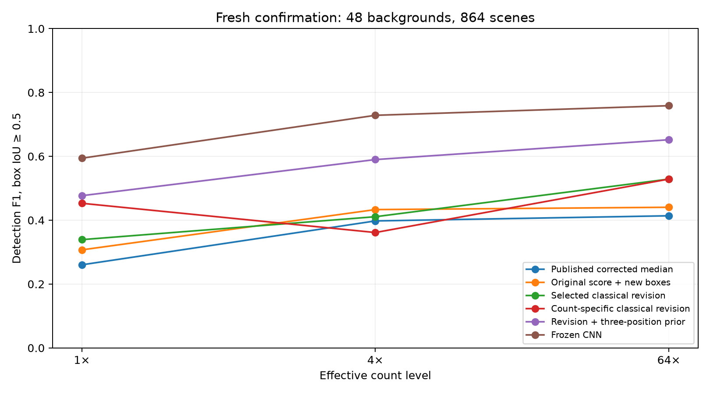
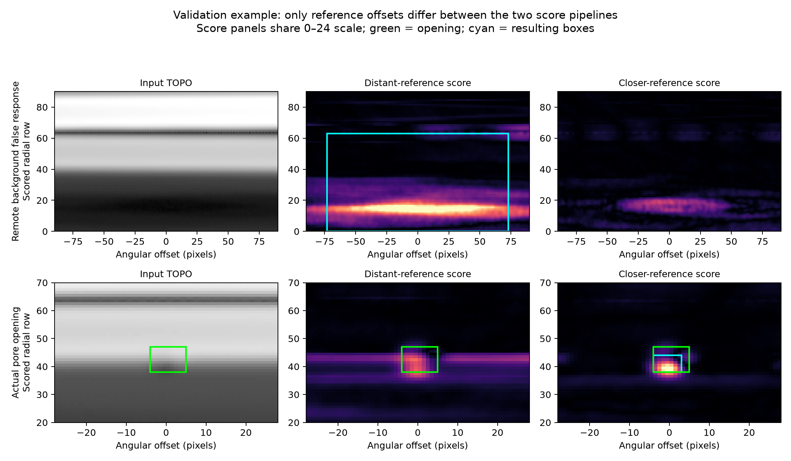
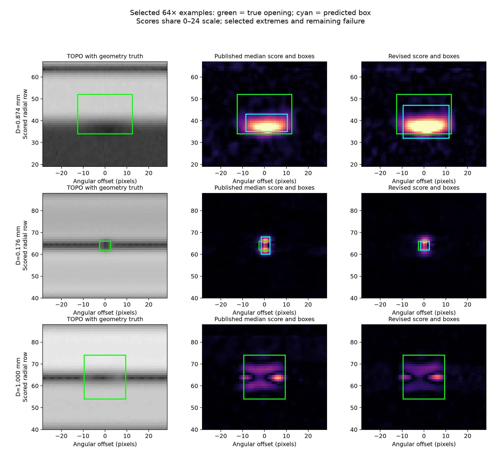
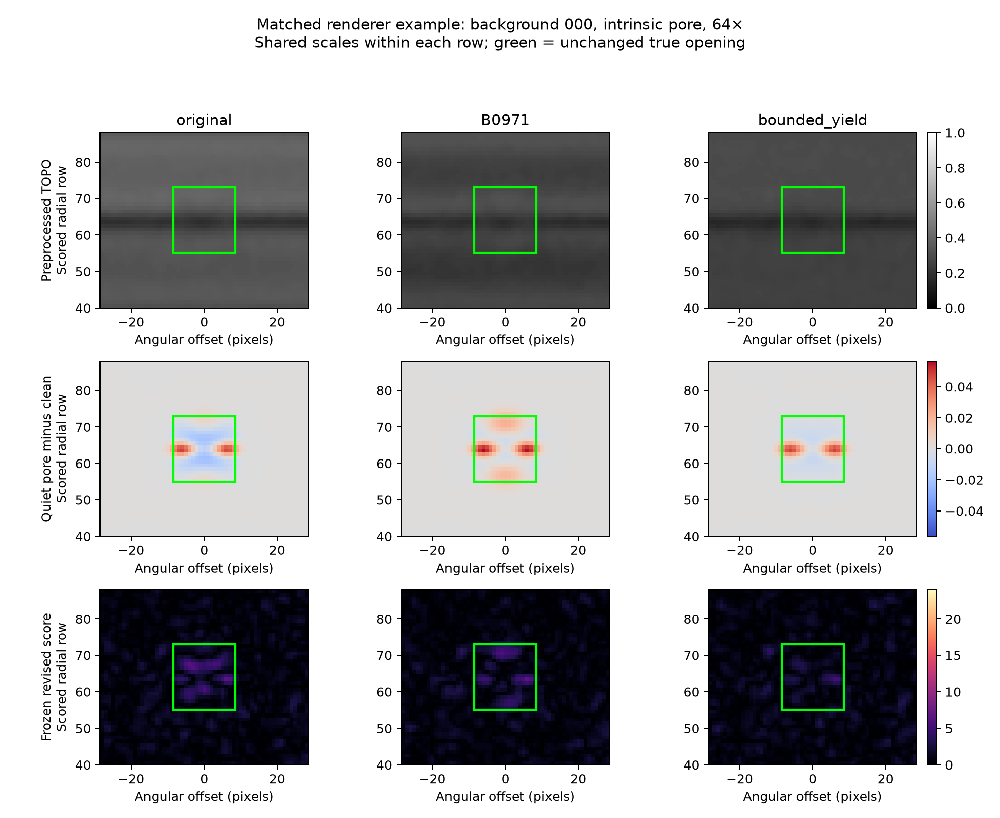

# Median improvement experiment

15 November 2026

## Principal findings

On fresh confirmation at 64×, the selected non-snapping classical revision achieved F1 0.529, compared with 0.414 for the published corrected median. The paired difference was +0.115, with a 95% background-bootstrap interval [+0.020, +0.208]. Correctly localised acquisitions changed from 72 to 92 of 192.

The evidence supports a 64× improvement within this synthetic experiment, not an improvement at every noise level. The 1× and 4× difference intervals include zero. At 1×, the revision increases precision while reducing recall: correct localisations fall from 76 to 49, while false regions fall from 316 to 48. At 4×, correct localisations are effectively unchanged (69 versus 68). The CNN remains stronger at all three levels.

The primary revision’s 64× validation F1 was 0.698, but fresh confirmation F1 was 0.529. Its mean F1 fell from 0.610 to 0.426. This development-to-confirmation gap limits confidence in the size of the validation gain. Selection optimism and sampling variation are plausible contributors; their separate effects have not been established. A 12-scene historical CNN replay reproduced archived boxes and metrics exactly, which checks that the new evaluation path matches the existing one.

The validation diagnostic retained 28 correct localisations with measured input and 26 with quiet input, using the same detector settings. Quiet input removes the acquisition stage, including noise and acquisition gain/contamination effects; it is not an isolated Poisson-noise ablation. This idealised input did not resolve the localisation bottleneck in that subset. The paired-clean oracle also did not make direct thresholded contrast equivalent to the opening mask under the tested extraction rules.

In the 64-pore validation diagnostic, the area filter reduced overlapping detections from 51 to 44; the existing box correction changed correctly localised detections from 14 to 28. These isolate particular processing stages, while the selected-policy comparison may change several settings together.

## What was done

Compared six residual-score constructions and 1,872 bounded configurations using the original 96 training and 32 validation backgrounds. New static calibrations used only clean training images. The input blur remained sigma 1 pixel. Candidate settings and the existing CNN were frozen before generating 48 new confirmation backgrounds (864 scenes; 192 pore and 96 clean scenes per count level). The image generator and historical datasets were preserved.

The published corrected median was replayed exactly on validation: mean per-count F1 0.39972199985. This checks the scoring and baseline implementation before comparing changes.

## Fresh confirmation results

| Method | 1× F1 | 4× F1 | 64× F1 | Mean F1 | Clean alarms at 64× |
|---|---:|---:|---:|---:|---:|
| Published corrected median | 0.260 | 0.398 | 0.414 | 0.357 | 2/96 |
| Original score + new boxes | 0.307 | 0.433 | 0.440 | 0.394 | 2/96 |
| Selected classical revision | 0.339 | 0.411 | 0.529 | 0.426 | 0/96 |
| Count-specific classical revision | 0.453 | 0.361 | 0.529 | 0.448 | 0/96 |
| Revision + three-position prior | 0.477 | 0.590 | 0.652 | 0.573 | 0/96 |
| Frozen CNN | 0.594 | 0.729 | 0.759 | 0.694 | 2/96 |



All rows use the same fresh scenes. The count-specific policy requires the acquisition count level to be known. The three-position method uses the simulator’s restricted radial-location prior and is not evidence of general localisation on arbitrary pore positions.

### Paired improvement over the published median

| Method | ΔF1 at 1× [95% interval] | ΔF1 at 4× [95% interval] | ΔF1 at 64× [95% interval] |
|---|---|---|---|
| Selected classical revision | +0.079 [-0.155, +0.226] | +0.013 [-0.084, +0.103] | +0.115 [+0.020, +0.208] |
| Revision + three-position prior | +0.217 [-0.020, +0.368] | +0.192 [+0.114, +0.278] | +0.238 [+0.150, +0.326] |
| Original score + new boxes | +0.047 [-0.021, +0.095] | +0.036 [-0.035, +0.106] | +0.027 [-0.041, +0.093] |
| Count-specific classical revision | +0.193 [-0.032, +0.341] | -0.036 [-0.198, +0.158] | +0.115 [+0.020, +0.208] |
| Frozen CNN | +0.334 [+0.023, +0.599] | +0.331 [+0.089, +0.572] | +0.345 [+0.115, +0.571] |

### What changed at 64×

| Method | TP | FP | FN | Precision | Recall | Missed with overlap | Missed without overlap |
|---|---:|---:|---:|---:|---:|---:|---:|
| Published corrected median | 72 | 84 | 120 | 0.462 | 0.375 | 67 | 53 |
| Selected classical revision | 92 | 64 | 100 | 0.590 | 0.479 | 64 | 36 |
| Frozen CNN | 165 | 78 | 27 | 0.679 | 0.859 | 12 | 15 |

A missed acquisition with overlap has a predicted box touching the true opening, but no box reaches IoU 0.5. A missed acquisition without overlap may have predictions elsewhere. FP counts include unmatched regions in defective scenes as well as clean-scene alarms.

| Pore diameter | Baseline correct / acquisitions | Revised correct / acquisitions | CNN correct / acquisitions |
|---|---:|---:|---:|
| below 0.3 mm | 18 / 56 | 18 / 56 | 39 / 56 |
| 0.3 to 0.6 mm | 42 / 76 | 60 / 76 | 74 / 76 |
| at least 0.6 mm | 12 / 60 | 14 / 60 | 52 / 60 |

Diameter groups are descriptive and include two acquisition repeats per geometry. These are recall counts, not independently sampled pores or group-specific F1 scores.

The revision recovers 18 additional medium-pore acquisitions (42 to 60), two additional large-pore acquisitions (12 to 14), and no net additional small-pore acquisitions (18 in both cases). Large-pore recall remains 14/60, compared with 52/60 for the CNN. Across all sizes, 64 of the revision’s 100 missed pore acquisitions still have an overlapping box below the IoU threshold. Thus opening extent remains a major limitation even after the improvement.


Intervals use 2,000 paired background bootstrap resamples at each count level. Related surfaces and repeats are resampled together, and the compared methods use the same background draws. They condition on the selected models, omit simulator error and selection variability, and are not adjusted for multiple exploratory comparisons.

### Operating points

- **Selected classical revision:** short_adaptive; threshold 16; closing 3; minimum area 3; width-derived height (aspect 1.6); merge=True; three-position snapping=False. Validation mean F1 0.610.
- **Original score + new boxes:** original_static; threshold 16; closing 1; minimum area 8; width-derived height (aspect 1); merge=True; three-position snapping=False. Validation mean F1 0.452.
- **Revision + three-position prior:** gauss_adaptive; threshold 12; closing 3; minimum area 3; width-derived height (aspect 1.6); merge=True; three-position snapping=True. Validation mean F1 0.617.
- **Count-specific 1×:** gauss_adaptive; threshold 8; closing 1; minimum area 8; width-derived height (aspect 1.6); merge=True; three-position snapping=False.
- **Count-specific 4×:** short_static; threshold 16; closing 3; minimum area 3; width-derived height (aspect 1.6); merge=True; three-position snapping=False.
- **Count-specific 64×:** short_adaptive; threshold 16; closing 3; minimum area 3; width-derived height (aspect 1.6); merge=True; three-position snapping=False.

### Exact selected detector

Blur the raw TOPO array with Gaussian sigma 1 pixel, then apply the unchanged training-derived intensity normalisation. At each row, form a median reference from angular offsets ±32, ±48, ±64 and ±80 pixels (1.6–4.0 mm at the campaign sampling). The previous reference used ±64, ±128, ±192 and ±256 pixels (3.2–12.8 mm).

Subtract this reference from the normalised image. For each row, estimate the residual median and 1.4826 times its median absolute deviation across angular columns, with a scale floor of 0.003. The score is the absolute centred residual divided by this scale. Threshold at 16, close with a 3 × 3 kernel, and retain connected components of at least 3 pixels. Angular boundaries are periodic.

Merge qualifying vertically separated components that overlap by at least half the narrower angular width, have a gap no greater than 8 pixels and combined extent no greater than 40 pixels. The implementation permits at most six merges. Shift the centre 2 rows towards the ring centre, expand angular width by 2 pixels, and infer height as max(3, expanded width / 1.6). Integer rounding and clipping follow the saved implementation. No snapping to the three nominal pore positions is used in the primary revision.

The inference entry point `WeldDefectDetection/apply_revised_median_20261115.py` accepts raw registered 160 × 5024 .npy arrays and returns cyclic boxes in both scored and raw coordinates. It does not access truth masks. Twelve prediction replays agreed exactly with the frozen experiment. Its default uses the single shared policy; `--count` optionally selects the frozen count-specific policy.


### Performance by score construction on validation

Each row below is its best non-snapping region configuration; differences can include separately selected postprocessing and are not isolated causal effects.

| Score | Best mean validation F1 |
|---|---:|
| original_static | 0.452 |
| original_adaptive | 0.432 |
| short_static | 0.549 |
| short_adaptive | 0.610 |
| gauss_static | 0.542 |
| gauss_adaptive | 0.580 |

### Controlled removals from the selected revision

Validation-only diagnostics hold the other selected settings fixed. These are descriptive checks after selection, not additional independent confirmation results.

| Change | 1× F1 | 4× F1 | 64× F1 | 64× TP / FP / FN |
|---|---:|---:|---:|---|
| selected | 0.508 | 0.623 | 0.698 | 82 / 25 / 46 |
| long_references | 0.436 | 0.464 | 0.389 | 61 / 125 / 67 |
| static_calibration | 0.039 | 0.641 | 0.672 | 77 / 24 / 51 |
| no_fragment_merge | 0.500 | 0.611 | 0.689 | 82 / 28 / 46 |
| original_box_extent | 0.443 | 0.557 | 0.638 | 75 / 32 / 53 |
| minimum_area_8 | 0.475 | 0.582 | 0.658 | 73 / 21 / 55 |
| published_baseline | 0.277 | 0.498 | 0.424 | 56 / 80 / 72 |

Restoring the distant reference offsets has the largest adverse effect in this combination. Static calibration mainly damages high-noise precision. Width-derived height and a smaller minimum area recover additional localisations. Disabling fragment merging has a smaller effect. These interactions do not justify attributing the total improvement to one operation.

### Direct clean-reference check

For 64 paired validation pore geometries, the median short-to-long ratio of noise-free clean-reference RMS error inside the opening was 0.783; the short reference had lower error in 38 of 64 geometries. The median ratio of long-to-short adaptive scale was 1.000 on measured images. Thus neither universal reference-bias reduction nor uniform scale inflation explains the whole F1 change. Threshold support and component geometry also change. Pore contamination of the median reference inside the opening had zero median and zero 90th percentile in this diagnostic. This does not exclude effects elsewhere on the ring.



This selected validation scene (val-031-open_intrinsic-c64-r0) illustrates both a remote background response and a missed local opening under distant references. All other detector settings are held fixed. The example illustrates the measured effect; it does not establish how frequently this particular appearance occurs.

A separate quiet-image check isolated changes to the median reference at locations outside the opening where the direct pore-induced image change was below 1e-5. Neither reference scheme produced a retained ghost component at threshold 16, area 3 and closing 3 in these 64 geometries. Maximum isolated ghost scores were 14.58 for distant references and 6.72 for closer references. This does not support strong isolated pore ghosts as the main explanation, although subthreshold contamination can still combine with background residuals.


## Mechanism diagnostics

These use validation repeat 0 at 64×: 32 backgrounds, 64 pore acquisitions and 32 clean acquisitions. They were not used as fresh confirmation evidence. Paired clean subtraction requires an unavailable defect-free counterpart and is an oracle diagnostic, not a proposed deployable method. Its per-image maximum normalisation and looser minimum area also change the operating conditions.

| Diagnostic | TP | FP | FN | F1 |
|---|---:|---:|---:|---:|
| measured | 28 | 28 | 36 | 0.467 |
| quiet | 26 | 17 | 38 | 0.486 |
| oracle_0.1_original | 21 | 68 | 43 | 0.275 |
| oracle_0.1_width | 22 | 67 | 42 | 0.288 |
| oracle_0.25_original | 30 | 37 | 34 | 0.458 |
| oracle_0.25_width | 34 | 33 | 30 | 0.519 |
| oracle_0.5_original | 34 | 34 | 30 | 0.515 |
| oracle_0.5_width | 40 | 28 | 24 | 0.606 |

Here `measured` and `quiet` use identical original-median calibration, threshold and box correction. Their difference isolates removal of the acquisition effects represented in the saved quiet image. `oracle` subtracts paired quiet clean and pore images after common preprocessing, then thresholds fractions of the difference maximum. Width reconstruction infers box height from angular width rather than equating the retained contrast region with the opening.

### Baseline stage counts

```json
{
  "pore_acquisitions": 64,
  "no_pixel_above_threshold_inside": 13,
  "overlap_before_area": 51,
  "overlap_after_area": 44,
  "matched_before_correction": 14,
  "matched_after_correction": 28
}
```

Overlap counts only establish that a component touches the opening. They do not establish accurate extent. A score below threshold inside the mask does not exclude a displaced response outside it.

## Illustrative cases



Examples are selected as the largest and smallest improved pore, plus a large remaining failure where available. They illustrate behaviour rather than estimate its frequency. Exact scene identities are recorded in results.json.

## Renderer sensitivity

Eight fixed new backgrounds were re-rendered at 64×, repeat 0 (16 pore and 8 clean acquisitions per variant), with identical geometry and acquisition settings. Original-mode replay was required to reproduce the saved images bit for bit. The same frozen detectors were used throughout, with no retuning.

- **B0971:** replace B = 0 with constant B = 0.971. This retains the known polar-law defect and extrapolates the scalar form beyond the checked CASINO tilt range.
- **Bounded yield:** use eta0 × [2/(1 + cos(alpha))]^(9/sqrt(Z)), preserving normal-incidence yield while replacing the early saturation of eta0/cos(alpha)^p. This is a sensitivity perturbation, not a calibrated physical correction.

| Method | Original 64× F1 | B = 0.971 F1 | Bounded-yield F1 |
|---|---:|---:|---:|
| Published corrected median | 0.333 | 0.308 | 0.000 |
| Original score + new boxes | 0.348 | 0.583 | 0.190 |
| Selected classical revision | 0.500 | 0.385 | 0.286 |
| Count-specific classical revision | 0.500 | 0.385 | 0.286 |
| Revision + three-position prior | 0.462 | 0.467 | 0.258 |
| Frozen CNN | 0.733 | 0.667 | 0.690 |



The displayed background and pore were fixed for illustration rather than selected for the largest change. The middle row uses a paired defect-free image unavailable at inference.

These are small, paired distribution-shift diagnostics. The training normalisation, calibration, thresholds and CNN weights remain unchanged, so sensitivity can include intensity scaling as well as spatial contrast. They do not determine the best detector after retraining under another renderer, or which renderer is physically correct.

The selected revision falls from F1 0.500 to 0.385 with B = 0.971 and to 0.286 with the bounded yield. The original-score reconstruction variant rises from 0.348 to 0.583 under B = 0.971, so the response is method-dependent. Neither renderer change supplies a general performance fix. Choosing a rendering law because it makes detection easier would not establish physical correctness; physical calibration must precede a new training and confirmation campaign.

## Recommended decision

Retain the selected closer-reference median as an improved 64× baseline and report its trade-offs at lower counts. Preserve the CNN as the stronger detector in this experiment. Do not replace the renderer solely to maximise detector F1, and do not claim that the new median resolves the localisation problem.

The next high-value algorithm experiment is size-aware opening reconstruction on development data: estimate a pore region from the signed contrast lobes or fit candidate pore-response shapes at several sizes, rather than infer every height from a single aspect ratio. This is motivated by the 64 overlapping misses and low large-pore recall, but has not been tested here. Any subsequent method must be frozen before evaluation on another fresh set.

The radial-snapping variant reaches 64× F1 0.652 in this experiment, but uses the three allowed simulator positions. It is a useful restricted-prior result, not the general recommendation. The count-specific variant is also reported in full; its 4× F1 of 0.361 is below the baseline 0.398, which cautions against assuming that more specialised validation tuning transfers better.

## Implication for the thesis

Treat this as a separately documented follow-up study. Preserve the historical confirmation table and add the new paired comparison, which uses different backgrounds. If the stronger baseline is adopted in the main discussion, describe its reference spacing, adaptive scaling and shape-based box reconstruction explicitly. Conclusions about the original implementation should not be broadened to all median-based detectors.

Suggested completed-study wording: An exploratory follow-up compared 1,872 classical detector configurations on the existing development split and froze the selected methods before generating 48 new confirmation backgrounds. At 64×, the selected median revision achieved detection F1 0.529, compared with 0.414 for the original corrected baseline on the same scenes. The improvement was 0.115 (paired 95% background-bootstrap interval 0.020 to 0.208). Validation diagnostics identified sensitivity to angular reference spacing, minimum region area and box reconstruction. Removing acquisition effects did not resolve the baseline localisation problem. These results establish that the original classical baseline was improvable within the specified synthetic distribution; they do not establish measured-image performance or physical validity of the renderer.

## Limits and reproduction

- All results remain synthetic, with known ring coordinates, one pore per defective scene, two prescribed pore families and three radial positions.
- The width-to-height reconstruction uses a pore-shape prior even when radial snapping is disabled. It requires testing on more diverse shapes.
- Validation was reused from prior work. Fresh confirmation reduces direct test reuse but does not make the study a preregistered independent replication.
- No new CNN was trained. The unchanged selected model provides a matched reference on the new images.
- Historical files and source dependencies are checked by hash. The new experiment is isolated in its own output directory.

Scripts: `WeldDefectDetection/median_exploration_20261115.py`, `WeldDefectDetection/median_renderer_sensitivity_20261115.py`, and `WeldDefectDetection/report_median_exploration_20261115.py`. Run them with the project `.venv/Scripts/python.exe`. Protocol, frozen settings, per-scene predictions, complete validation trials, and bootstrap summaries are in `DataSimulation/data/output/median_exploration_20261115_v1`.

Main run order: `prepare`, `development`, `freeze`, `generate`, `confirm`, `cnn`; renderer sensitivity: `prepare`, `generate`, `evaluate`; then run the report script. Existing completed per-scene work is reused. Do not rerun `freeze` after confirmation generation.
