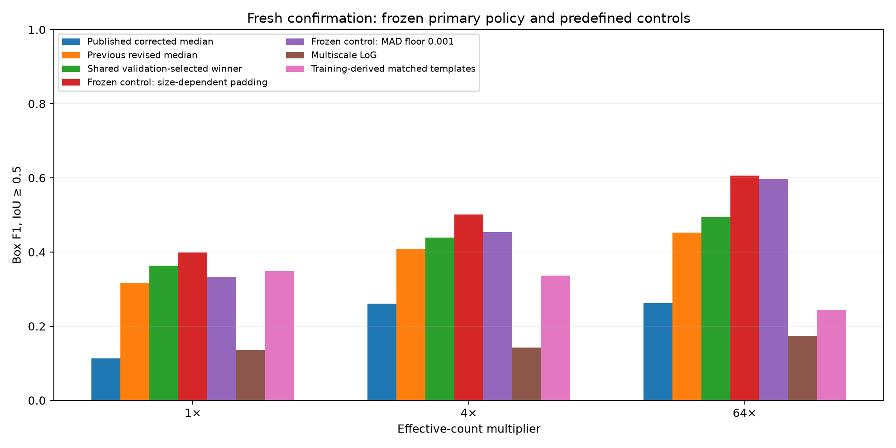
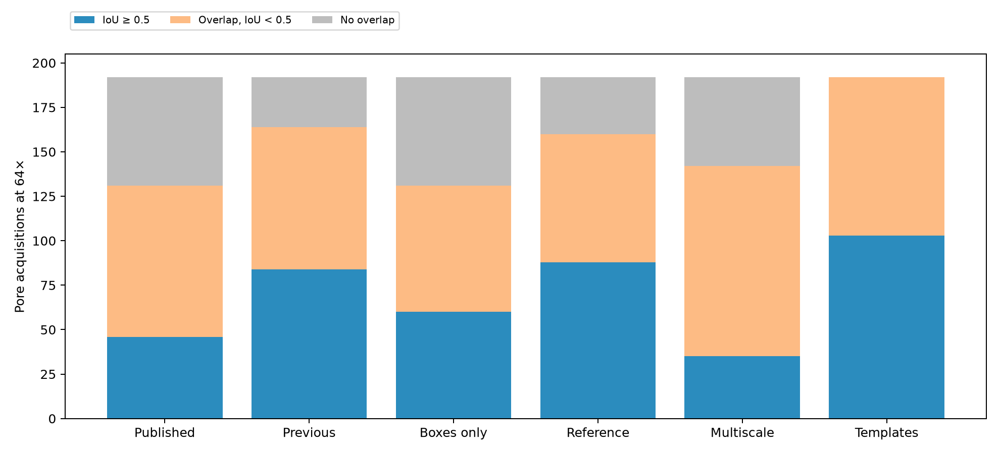
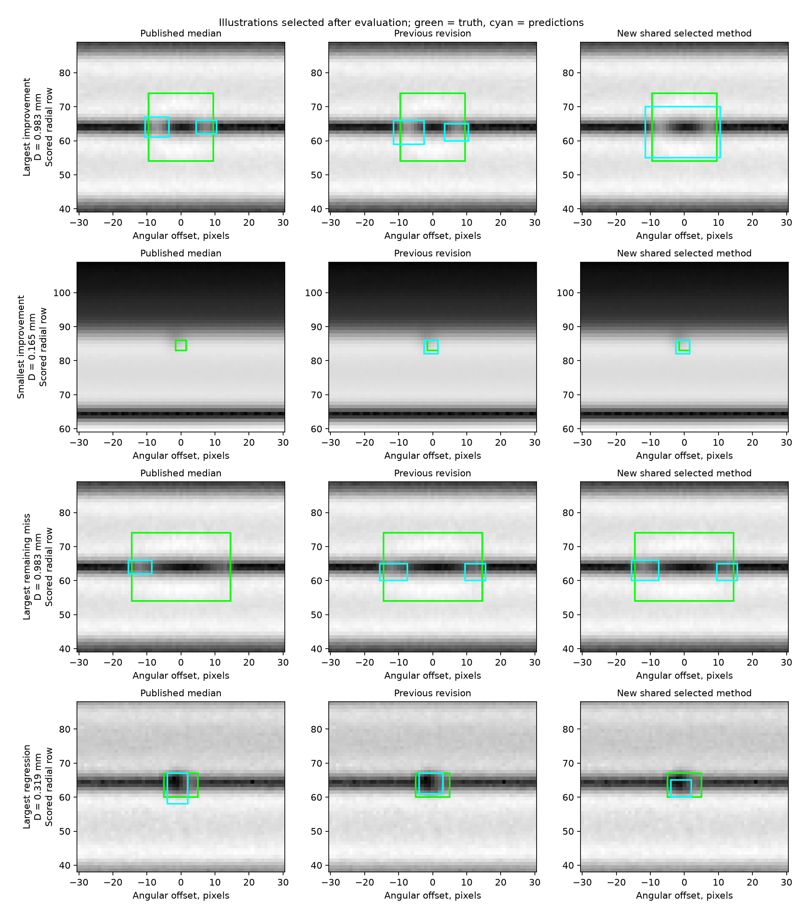
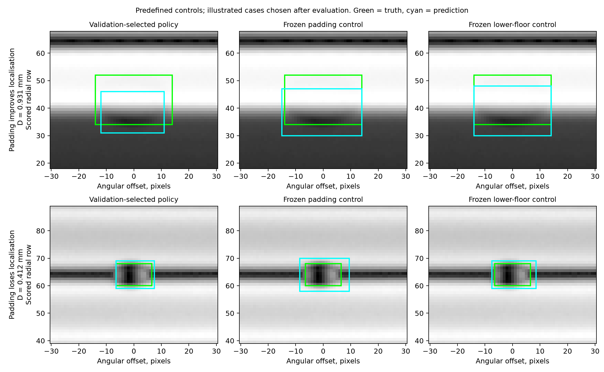

# Separate median experiment: boxes, scales, templates and references

15 November 2026. All numerical comparisons below use the same fresh confirmation scenes unless explicitly labelled validation or historical. The renderer and previous experiments were preserved.

## Principal result

The shared validation-selected method is **components**, with operating point `{"area": 3, "family": "components", "gap": 10, "pad_fraction": 0, "score": "near_adaptive_0.003", "shape": "width1.6", "shift": "fixed", "threshold": 16.0}`.
At 64× it achieves F1 **0.494**, compared with **0.262** for the published corrected median and **0.453** for the previous revision.
The paired gain over the published median is **+0.232**, 95% background-bootstrap interval **[+0.131, +0.342]**. Relative to the previous revision it is **+0.042 [-0.019, +0.105]**.
A predefined padding control, frozen before confirmation, performs better on this fresh sample: **64× F1 0.607**, with **108 TP and 56 FP**, versus **84 TP and 95 FP** for the previous revision. Its paired difference from that revision is **+0.154 [0.046, 0.253]**. This is an exploratory control comparison with an unadjusted interval, not the validation-selected primary result. No setting was changed after seeing confirmation.
A positive point difference is not automatically a confirmed improvement: inspect the interval and the per-count precision/recall results below. No new CNN was trained or evaluated in this median-only experiment.

## What was tested

- Box formation: component gaps 0, 4 and 10 pixels; minimum areas 3 and 8; original or row-dependent shifts; fixed or size-proportional padding; union extent or width-derived height.
- Score calibration: per-image row MAD and count-specific clean-training row MAD; floors 0.003, 0.001 and 0.0003; thresholds 4, 8, 12, 16 and 24.
- Reference construction: original offsets ±64/128/192/256; previous ±32/48/64/80; closer guarded ±16/24/32/48; robust periodic fit with harmonics 1 through 5.
- Multiscale response: sigma-squared-normalised Laplacian at sigma 1, 2, 4 and 8; maxima over space and scale; candidate box size from the winning scale, with validation-selected extent factor and aspect.
- Matched templates: 18 signed, unit-energy average training responses from paired quiet pore/clean images, grouped by pore family, diameter group and radial position. Prototype widths and heights use training masks. These are label-informed classical templates, not an unsupervised median filter.
- Count-specific selection: select a separate policy for each known count level, alongside the single shared policy.

Development used the original 96 training and 32 validation backgrounds. 704 configuration evaluations, including comparators and locked controls, are recorded, representing 685 distinct serialized operating points. Duplicate operating points can occur across stages. The search began sequentially: select boxes, then tune scores/references with those boxes fixed. A documented development-only amendment then revisited all 72 box settings at the best initial score operating point in each reference/calibration branch. This avoided forcing the original-score box optimum onto a different reference. It is not the Cartesian product of every possible setting.
All policies and dependencies were frozen before generating 48 previously unused backgrounds, yielding 864 scenes: 192 pore and 96 clean acquisitions per count. Validation was reused from earlier work, so this remains exploratory rather than a preregistered replication.

The scale-space implementation follows the normalised-derivative/extremum principle described by [Lindeberg](https://www.csc.kth.se/cvap/abstracts/cvap198.html). Its box-size conversion is an experimental approximation for pore contrast, not a theorem about opening boundaries. The sigma-1 input preprocessing remains in place before the additional LoG scales.

## Fresh confirmation results

| Method | 1× F1 | 4× F1 | 64× F1 | Mean F1 | 64× clean alarms |
|---|---:|---:|---:|---:|---:|
| Published corrected median | 0.114 | 0.261 | 0.262 | 0.212 | 2/96 |
| Previous revised median | 0.316 | 0.409 | 0.453 | 0.393 | 0/96 |
| Box changes only | 0.136 | 0.348 | 0.342 | 0.275 | 2/96 |
| Adaptive scale, distant reference | 0.204 | 0.326 | 0.366 | 0.299 | 8/96 |
| Count-calibrated scale, distant reference | 0.172 | 0.434 | 0.430 | 0.345 | 11/96 |
| Selected reference and scale | 0.364 | 0.439 | 0.494 | 0.432 | 0/96 |
| Multiscale LoG | 0.136 | 0.142 | 0.175 | 0.151 | 0/96 |
| Training-derived matched templates | 0.348 | 0.336 | 0.243 | 0.309 | 1/96 |
| Shared validation-selected winner | 0.364 | 0.439 | 0.494 | 0.432 | 0/96 |
| Count-specific validation winners | 0.364 | 0.439 | 0.494 | 0.432 | 0/96 |
| Frozen control: size-dependent padding | 0.399 | 0.502 | 0.607 | 0.502 | 0/96 |
| Frozen control: MAD floor 0.001 | 0.333 | 0.454 | 0.596 | 0.461 | 1/96 |

The shared winner was chosen using mean validation F1, not whichever method happens to score best on confirmation. In this run it is the selected reference/component policy, so those two rows coincide. The count-specific winners also coincide with that shared policy. These are policy-selection roles, not independent methods. Family-level policies are all shown to avoid selecting only favourable results.

The padding control and lower-floor control are shown because they test the requested mechanisms. Their stronger confirmation scores do not retroactively make them the validation-selected winners.

### Recall and precision across count levels

| Count | Method | TP | FP | FN | Precision | Recall |
|---|---|---:|---:|---:|---:|---:|
| 1× | Published corrected median | 46 | 571 | 146 | 0.075 | 0.240 |
| 1× | Previous revised median | 47 | 58 | 145 | 0.448 | 0.245 |
| 1× | Shared validation-selected winner | 52 | 42 | 140 | 0.553 | 0.271 |
| 1× | Frozen control: size-dependent padding | 57 | 37 | 135 | 0.606 | 0.297 |
| 1× | Frozen control: MAD floor 0.001 | 51 | 63 | 141 | 0.447 | 0.266 |
| 4× | Published corrected median | 45 | 108 | 147 | 0.294 | 0.234 |
| 4× | Previous revised median | 67 | 69 | 125 | 0.493 | 0.349 |
| 4× | Shared validation-selected winner | 70 | 57 | 122 | 0.551 | 0.365 |
| 4× | Frozen control: size-dependent padding | 80 | 47 | 112 | 0.630 | 0.417 |
| 4× | Frozen control: MAD floor 0.001 | 76 | 67 | 116 | 0.531 | 0.396 |
| 64× | Published corrected median | 46 | 113 | 146 | 0.289 | 0.240 |
| 64× | Previous revised median | 84 | 95 | 108 | 0.469 | 0.438 |
| 64× | Shared validation-selected winner | 88 | 76 | 104 | 0.537 | 0.458 |
| 64× | Frozen control: size-dependent padding | 108 | 56 | 84 | 0.659 | 0.562 |
| 64× | Frozen control: MAD floor 0.001 | 116 | 81 | 76 | 0.589 | 0.604 |

### Paired differences from published median

| Method | 1× ΔF1 [95% interval] | 4× ΔF1 [95% interval] | 64× ΔF1 [95% interval] |
|---|---|---|---|
| Box changes only | +0.022 [-0.005, +0.107] | +0.087 [+0.019, +0.152] | +0.080 [+0.018, +0.142] |
| Adaptive scale, distant reference | +0.090 [-0.119, +0.193] | +0.065 [-0.024, +0.164] | +0.104 [+0.015, +0.208] |
| Count-calibrated scale, distant reference | +0.058 [-0.078, +0.108] | +0.173 [+0.072, +0.280] | +0.168 [+0.026, +0.327] |
| Selected reference and scale | +0.250 [+0.045, +0.365] | +0.178 [+0.078, +0.283] | +0.232 [+0.131, +0.342] |
| Multiscale LoG | +0.022 [-0.195, +0.129] | -0.119 [-0.246, -0.001] | -0.088 [-0.205, +0.025] |
| Training-derived matched templates | +0.234 [+0.008, +0.328] | +0.076 [-0.063, +0.204] | -0.019 [-0.145, +0.109] |
| Shared validation-selected winner | +0.250 [+0.045, +0.365] | +0.178 [+0.078, +0.283] | +0.232 [+0.131, +0.342] |
| Count-specific validation winners | +0.250 [+0.045, +0.365] | +0.178 [+0.078, +0.283] | +0.232 [+0.131, +0.342] |
| Frozen control: size-dependent padding | +0.285 [+0.078, +0.398] | +0.241 [+0.121, +0.351] | +0.345 [+0.226, +0.463] |
| Frozen control: MAD floor 0.001 | +0.220 [+0.009, +0.334] | +0.193 [+0.039, +0.339] | +0.334 [+0.162, +0.507] |

Intervals use 2,000 paired background resamples, retaining all related scenes and repeats together. They condition on the frozen selections, omit simulator and selection uncertainty, and are not adjusted for the multiple exploratory comparisons.

### Counts and localisation at 64×

| Method | TP | FP | FN | Precision | Recall | Missed with overlap | Missed without overlap |
|---|---:|---:|---:|---:|---:|---:|---:|
| Published corrected median | 46 | 113 | 146 | 0.289 | 0.240 | 85 | 61 |
| Previous revised median | 84 | 95 | 108 | 0.469 | 0.438 | 80 | 28 |
| Box changes only | 60 | 99 | 132 | 0.377 | 0.312 | 71 | 61 |
| Adaptive scale, distant reference | 74 | 138 | 118 | 0.349 | 0.385 | 67 | 51 |
| Count-calibrated scale, distant reference | 94 | 151 | 98 | 0.384 | 0.490 | 73 | 25 |
| Selected reference and scale | 88 | 76 | 104 | 0.537 | 0.458 | 72 | 32 |
| Multiscale LoG | 35 | 174 | 157 | 0.167 | 0.182 | 107 | 50 |
| Training-derived matched templates | 103 | 551 | 89 | 0.157 | 0.536 | 89 | 0 |
| Shared validation-selected winner | 88 | 76 | 104 | 0.537 | 0.458 | 72 | 32 |
| Count-specific validation winners | 88 | 76 | 104 | 0.537 | 0.458 | 72 | 32 |
| Frozen control: size-dependent padding | 108 | 56 | 84 | 0.659 | 0.562 | 52 | 32 |
| Frozen control: MAD floor 0.001 | 116 | 81 | 76 | 0.589 | 0.604 | 74 | 2 |

| Method | Pores with any overlap | Strict FP that overlap a pore | Strict FP with no overlap | Any-overlap F1 |
|---|---:|---:|---:|---:|
| Published corrected median | 131/192 | 106 | 7 | 0.746 |
| Previous revised median | 164/192 | 95 | 0 | 0.884 |
| Selected reference and scale | 160/192 | 76 | 0 | 0.899 |
| Frozen control: size-dependent padding | 160/192 | 56 | 0 | 0.899 |
| Frozen control: MAD floor 0.001 | 190/192 | 76 | 5 | 0.977 |
| Multiscale LoG | 142/192 | 174 | 0 | 0.708 |
| Training-derived matched templates | 192/192 | 352 | 199 | 0.454 |

Overlapping false-positive regions include insufficient-IoU boxes and extra boxes competing for one truth object. These counts distinguish localisation/duplication from responses away from the labelled opening; they do not establish a unique algorithmic cause.

### Pore-size recall at 64×

| Method | Below 0.3 mm | 0.3–0.6 mm | At least 0.6 mm |
|---|---:|---:|---:|
| Published corrected median | 11/60 | 29/52 | 6/80 |
| Previous revised median | 26/60 | 41/52 | 17/80 |
| Box changes only | 14/60 | 32/52 | 14/80 |
| Adaptive scale, distant reference | 20/60 | 38/52 | 16/80 |
| Count-calibrated scale, distant reference | 22/60 | 37/52 | 35/80 |
| Selected reference and scale | 26/60 | 38/52 | 24/80 |
| Multiscale LoG | 12/60 | 13/52 | 10/80 |
| Training-derived matched templates | 4/60 | 35/52 | 64/80 |
| Shared validation-selected winner | 26/60 | 38/52 | 24/80 |
| Count-specific validation winners | 26/60 | 38/52 | 24/80 |
| Frozen control: size-dependent padding | 22/60 | 44/52 | 42/80 |
| Frozen control: MAD floor 0.001 | 16/60 | 34/52 | 66/80 |

These are acquisition-level counts, including repeated views of the same geometry, not independent pore specimens.

### Validation-to-confirmation transfer

| Method | Validation mean F1 | Confirmation mean F1 | Validation 64× F1 | Confirmation 64× F1 |
|---|---:|---:|---:|---:|
| Published corrected median | 0.400 | 0.212 | 0.424 | 0.262 |
| Previous revised median | 0.610 | 0.393 | 0.698 | 0.453 |
| Box changes only | 0.435 | 0.275 | 0.492 | 0.342 |
| Adaptive scale, distant reference | 0.453 | 0.299 | 0.452 | 0.366 |
| Count-calibrated scale, distant reference | 0.413 | 0.345 | 0.368 | 0.430 |
| Selected reference and scale | 0.621 | 0.432 | 0.716 | 0.494 |
| Multiscale LoG | 0.279 | 0.151 | 0.310 | 0.175 |
| Training-derived matched templates | 0.261 | 0.309 | 0.218 | 0.243 |
| Shared validation-selected winner | 0.621 | 0.432 | 0.716 | 0.494 |
| Frozen control: size-dependent padding | 0.511 | 0.502 | 0.585 | 0.607 |
| Frozen control: MAD floor 0.001 | 0.441 | 0.461 | 0.361 | 0.596 |

Differences can reflect selection optimism and sampling variation. This experiment does not isolate their respective contributions.

### Why the validation ranking needs caution

Validation contains 60 small, 44 medium and 24 large pore acquisitions per count. Fresh confirmation contains 60, 52 and 80 respectively. Large pores therefore account for 18.8% of validation pore acquisitions but 41.7% of fresh pore acquisitions. The large-pore validation group spans only six independent backgrounds, compared with twenty in fresh confirmation.
Radial-position composition also differs: the large-pore validation group has 4 inner-flank, 16 centre and 4 outer-flank acquisitions, versus 28/28/24 in fresh confirmation. These are observational differences between samples, not controlled causal interventions.
| Policy | Validation small | Validation medium | Validation large | Fresh small | Fresh medium | Fresh large |
|---|---:|---:|---:|---:|---:|---:|
| Previous revised median | 43/60 | 38/44 | 1/24 | 26/60 | 41/52 | 17/80 |
| Shared validation-selected winner | 45/60 | 37/44 | 0/24 | 26/60 | 38/52 | 24/80 |
| Frozen control: size-dependent padding | 25/60 | 40/44 | 2/24 | 22/60 | 44/52 | 42/80 |
| Frozen control: MAD floor 0.001 | 5/60 | 35/44 | 10/24 | 16/60 | 34/52 | 66/80 |

These are recall counts, not size-specific F1. The reversal is not explained by size frequencies alone: performance within size groups also changes. A future development set should cover size and radial-position combinations across more independent backgrounds, and report size-stratified performance alongside the aggregate objective. Keep this confirmation set out of that new selection process.

### Reference alternatives on validation

| Reference/calibration branch | Best mean validation F1 | Best operating point |
|---|---:|---|
| long_adaptive | 0.453 | `{"area": 8, "family": "components", "gap": 0, "pad_fraction": 0, "score": "long_adaptive_0.003", "shape": "width1.6", "shift": "row", "threshold": 16.0}` |
| long_count | 0.413 | `{"area": 3, "family": "components", "gap": 10, "pad_fraction": 0.1, "score": "long_count_0.003", "shape": "width1.6", "shift": "row", "threshold": 16.0}` |
| short_adaptive | 0.610 | `{"area": 3, "family": "components", "gap": 4, "pad_fraction": 0, "score": "short_adaptive_0.003", "shape": "width1.6", "shift": "fixed", "threshold": 16.0}` |
| near_adaptive | 0.621 | `{"area": 3, "family": "components", "gap": 10, "pad_fraction": 0, "score": "near_adaptive_0.003", "shape": "width1.6", "shift": "fixed", "threshold": 16.0}` |
| periodic_adaptive | 0.441 | `{"area": 3, "family": "components", "gap": 10, "pad_fraction": 0, "score": "periodic_adaptive_0.003", "shape": "width1.6", "shift": "fixed", "threshold": 16.0}` |

These are development results after a bounded search, not fresh confirmation for every reference branch. Only frozen policies listed in the confirmation table were evaluated as confirmation comparisons.

## Checking the proposed explanation

### Historical 64× boxes

Direct inspection confirms 147 of 192 pore acquisitions have an overlapping prediction. There are 161 predicted regions, all of which touch a pore. Strict IoU ≥ 0.5 matching yields 68 TP, 93 FP and 124 FN. Relaxing matching to any overlap yields 147 TP and 14 FP; those 14 are excess/duplicate predictions, not off-pore regions. Thus all 93 strict false-positive regions have some overlap, rather than only approximately 79.
The 79 newly matched acquisitions are the increase in matched pores under the relaxed rule. They are not a complete classification of all false-positive boxes. The resulting F1 is 0.832861. This is a conditional value with the existing prediction count, not a hard ceiling after merging duplicates, dropping regions or recovering previously missed pores.
A box that touches a pore is evidence of a response near it, but can still be a poor opening estimate. One unmatched box plus one missed pore contributes both FP and FN under the stated detection metric. Relaxing IoU changes the task being measured; it does not repair localisation. Fixed pipeline settings also do not make their outputs independent of noise: noise can still change threshold support, connectivity and box geometry.

### Score floor and structure

The 0.003 floor implies a minimum residual cutoff of 0.048 at threshold 16. The actual original per-row cutoff has minimum/median/maximum approximately **0.048/0.0683/0.0909**. Therefore the score is not a uniform 0.048 test.
The raw-image repeat-variability ratio does not directly determine how a normalised residual threshold should scale. Square-root normalisation, preprocessing and persistent surface residuals matter. Per-image MAD is robust to sparse pore pixels, but it estimates residual spread including structure, and a small pore fraction alone does not guarantee suitable calibration.

| Reference | 64× clean residual RMS | Quiet clean residual RMS | Median paired quiet-residual/repeat-noise RMS | Median fraction of rows at 0.003 floor |
|---|---:|---:|---:|---:|
| long | 0.004744 | 0.004083 | 2.337 | 0.453 |
| short | 0.002324 | 0.001395 | 0.825 | 0.930 |
| near | 0.001956 | 0.001262 | 0.721 | 0.922 |
| periodic | 0.003918 | 0.002785 | 1.938 | 0.570 |

The median repeat-noise RMS is 0.001652 in the same preprocessed normalised coordinates. Ratios are medians of paired ratios, not ratios of displayed medians. These diagnostics use 32 clean validation backgrounds and remove no regions using test labels.
The distant reference leaves substantial quiet-image structure, and closer references reduce it in this diagnostic. This supports testing reference bias. It does not establish that crown harmonic amplitude alone causes the detector failures.

### Crown-variation amplitude

| Amplitude a | Historical 64× median F1 | Historical pore acquisitions | Fresh baseline F1 | Fresh shared-selected F1 |
|---|---:|---:|---:|---:|
| 0 | 0.292 | 76 | 0.427 | 0.571 |
| 0.05 | 0.400 | 52 | 0.099 | 0.444 |
| 0.1 | 0.476 | 64 | 0.201 | 0.444 |

These groups contain different backgrounds and pore sizes, so they are descriptive associations rather than a controlled amplitude ablation. The historical scores increase with amplitude, contrary to a simple claim that larger amplitude necessarily explains poorer median performance.

## Locked component ablations

Each displayed control changes one setting of the selected reference/component policy without retuning. Locked controls that reproduce its existing setting are omitted from this table as exact duplicates, but remain in the evidence files. This provides a more direct comparison than subtracting results from separately optimised families. It is not an ablation of the template method.

| Policy | 1× F1 | 4× F1 | 64× F1 | 64× difference from selected [95% interval] |
|---|---:|---:|---:|---|
| reference | 0.364 | 0.439 | 0.494 | +0.000 [+0.000, +0.000] |
| ablation_no_merge | 0.293 | 0.371 | 0.403 | -0.091 [-0.161, -0.032] |
| ablation_area8 | 0.353 | 0.388 | 0.485 | -0.010 [-0.054, +0.028] |
| ablation_long_reference | 0.288 | 0.379 | 0.412 | -0.082 [-0.174, +0.020] |
| control_row_shift | 0.343 | 0.376 | 0.438 | -0.056 [-0.124, +0.011] |
| control_proportional_padding | 0.399 | 0.502 | 0.607 | +0.112 [+0.006, +0.202] |
| control_lower_floor | 0.333 | 0.454 | 0.596 | +0.102 [-0.057, +0.252] |
| control_previous_reference | 0.369 | 0.442 | 0.520 | +0.025 [-0.003, +0.058] |

The measured quiet-contrast centroid displacement is not necessarily the displacement of a thresholded component box. Consequently, substituting those centroid offsets for a box correction requires an empirical test. Likewise, a scale-normalised extremum sizes a contrast feature, which need not equal the whole opening. These distinctions explain why the proposals are plausible experiments rather than guaranteed improvements; the tables establish performance, not a unique causal explanation for each failure.

## Frozen operating points

- **Published corrected median:** `{"family": "baseline"}`
- **Previous revised median:** `{"family": "previous"}`
- **Box changes only:** `{"area": 8, "family": "components", "gap": 0, "pad_fraction": 0.1, "score": "baseline", "shape": "width1.6", "shift": "row", "threshold": 16.0}`
- **Adaptive scale, distant reference:** `{"area": 8, "family": "components", "gap": 0, "pad_fraction": 0, "score": "long_adaptive_0.003", "shape": "width1.6", "shift": "row", "threshold": 16.0}`
- **Count-calibrated scale, distant reference:** `{"area": 3, "family": "components", "gap": 10, "pad_fraction": 0.1, "score": "long_count_0.003", "shape": "width1.6", "shift": "row", "threshold": 16.0}`
- **Selected reference and scale:** `{"area": 3, "family": "components", "gap": 10, "pad_fraction": 0, "score": "near_adaptive_0.003", "shape": "width1.6", "shift": "fixed", "threshold": 16.0}`
- **Multiscale LoG:** `{"aspect": 1.6, "factor": 1.5, "family": "multiscale", "reference": "near", "shift": "row", "threshold": 24}`
- **Training-derived matched templates:** `{"factor": 1.2, "family": "templates", "reference": "long", "threshold": 12}`
- **Shared validation-selected winner:** `{"area": 3, "family": "components", "gap": 10, "pad_fraction": 0, "score": "near_adaptive_0.003", "shape": "width1.6", "shift": "fixed", "threshold": 16.0}`
- **Count-specific validation winners:** `{"1": {"area": 3, "family": "components", "gap": 10, "pad_fraction": 0, "score": "near_adaptive_0.003", "shape": "width1.6", "shift": "fixed", "threshold": 16.0}, "4": {"area": 3, "family": "components", "gap": 10, "pad_fraction": 0, "score": "near_adaptive_0.003", "shape": "width1.6", "shift": "fixed", "threshold": 16.0}, "64": {"area": 3, "family": "components", "gap": 10, "pad_fraction": 0, "score": "near_adaptive_0.003", "shape": "width1.6", "shift": "fixed", "threshold": 16.0}}`
- **Frozen control: size-dependent padding:** `{"area": 3, "family": "components", "gap": 10, "pad_fraction": 0.1, "score": "near_adaptive_0.003", "shape": "width1.6", "shift": "fixed", "threshold": 16.0}`
- **Frozen control: MAD floor 0.001:** `{"area": 3, "family": "components", "gap": 10, "pad_fraction": 0, "score": "near_adaptive_0.001", "shape": "width1.6", "shift": "fixed", "threshold": 16.0}`

Merging uses Euclidean distance between component bounding rectangles, with a maximum union width/height of 40 pixels to limit chains of unrelated regions. Fragments smaller than 3 pixels are removed by the existing component extractor; the selected area requirement is applied after merging. The row-dependent correction interpolates +1.54 pixels at the inner flank, zero at the centre and −1.17 at the outer flank. It uses the previously measured training diagnostic and does not snap boxes to three discrete rows. The original fixed-inward rule already gives zero shift exactly at row 64; the proposed interpolation changes its behaviour around the centre and on the flanks.
Proportional padding is 1 pixel plus the selected fraction of the larger component dimension per side. Width-derived height imposes a fixed aspect prior. Multiscale/template candidates undergo periodic nonmaximum suppression at IoU 0.2, with no top-k truncation. Templates are evaluated across the whole ring without supplying a pore location. Their labelled training geometry remains a substantive prior.

## Illustrative cases

Examples were selected after evaluation using fixed descriptive rules: largest/smallest improvement, largest remaining miss and largest regression where available. They illustrate mechanisms and do not estimate frequencies. Exact identities are in results.json.

The additional control figure shows the largest padding improvement and largest padding regression, where available. This illustrates the extent trade-off without hiding a less favourable case.

## Decision supported by this experiment

The selected method improves 64× F1 over the published corrected median with a paired interval entirely above zero.
The incremental 64× improvement over the previous revision is not established: its paired interval is not entirely above zero. Do not describe the validation advantage as a confirmed upgrade.
The frozen padding control is the strongest next candidate for confirmation. At 64× it improves large-pore correct localisations from 17/80 under the previous revision to 42/80, while small-pore correct localisations fall from 26/60 to 22/60. Lowering the MAD floor reaches 66/80 large pores but only 16/60 small pores, illustrating a different trade-off.
The padding and lower-floor controls both ranked worse on validation but better on fresh confirmation than the primary selected policy. This ranking reversal is evidence of unstable transfer across these finite samples. More large pores occur in this fresh set than in the preceding confirmation set, which can affect aggregate scores; it does not by itself prove the cause of the reversal. Do not combine the better-performing controls or retune them on this confirmation set and call the outcome independently validated.
For a thesis, report the primary policy and the favourable frozen controls separately. To promote the padding control to the default method, keep its current settings fixed and evaluate it on another untouched sample. The present results support further testing and establish observed synthetic gains; they do not establish which policy will consistently perform best.
Choose an operating point with the required recall/false-alarm trade-off in mind. An F1 gain accompanied by lower low-count recall is not an improvement in every practical detection objective. Keep the published historical comparison intact and report this experiment separately.
The count-specific selector chose the same operating point at all three levels in this bounded candidate set. It therefore adds no benefit over the shared selected policy here.

## Reproduction and limits

- Main script: `WeldDefectDetection/median_scale_templates_20261115.py`. Run `prepare` and `development`, then the refinement and lock scripts below, then `generate` and `confirm`, using the project virtual environment. Do not refreeze after confirmation begins.
- Development amendment: `WeldDefectDetection/refine_median_scale_templates_20261115.py`. Final controls and freeze: `WeldDefectDetection/lock_median_scale_templates_20261115.py`. The protocol preserves the timing and reason for the amendment.
- Optional concurrent evaluation: `WeldDefectDetection/stream_median_scale_templates_20261115.py` evaluates completed backgrounds using frozen policies while generation continues. The final `confirm` action assembles all results.
- Diagnostics: `WeldDefectDetection/diagnose_median_scale_templates_20261115.py`.
- Report and verification: `WeldDefectDetection/report_median_scale_templates_20261115.py`.
- Truth-free inference: `WeldDefectDetection/apply_median_scale_templates_20261115.py input.npy --count 64 --policy selected`. The array must be raw registered TOPO with shape 160 × 5024. Output includes scored and raw-coordinate cyclic boxes.
- Full evidence: `DataSimulation/data/output/median_scale_templates_20261115_v1`, including protocol, templates, training calibration, all validation trials, frozen policies, per-scene confirmation predictions, diagnostics and audit.
- Audit passed: 864 image hashes, 17280 prediction records independently re-scored, and 36 standalone inference replays.
- All performance remains synthetic and assumes nominal ring coordinates. The experiment preserves the same renderer, restricted pore families and one-pore scene design. It establishes algorithmic performance under that distribution, not physical correctness or transfer to measured welds.
- A template improvement cannot be described as a gain from median filtering alone. Template dimensions and responses are learned from labelled synthetic training geometries. The distinction is a learned template model versus a CNN, not labelled versus unlabelled learning.
- The finite, sequential search can miss interactions and stronger settings. A negative result for this multiscale or periodic implementation does not disprove those method classes.
- Timing checks are descriptive only, use three scenes per policy and include dependency verification. Detailed values are in audit.json.
